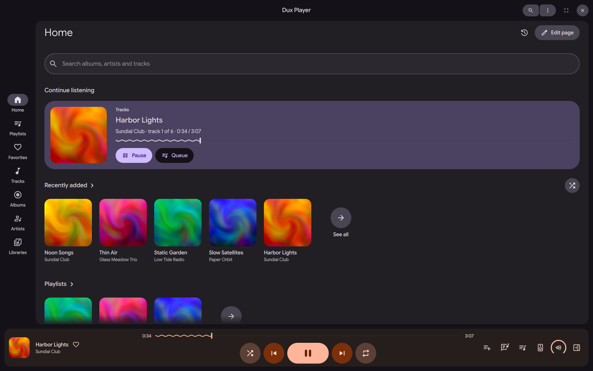
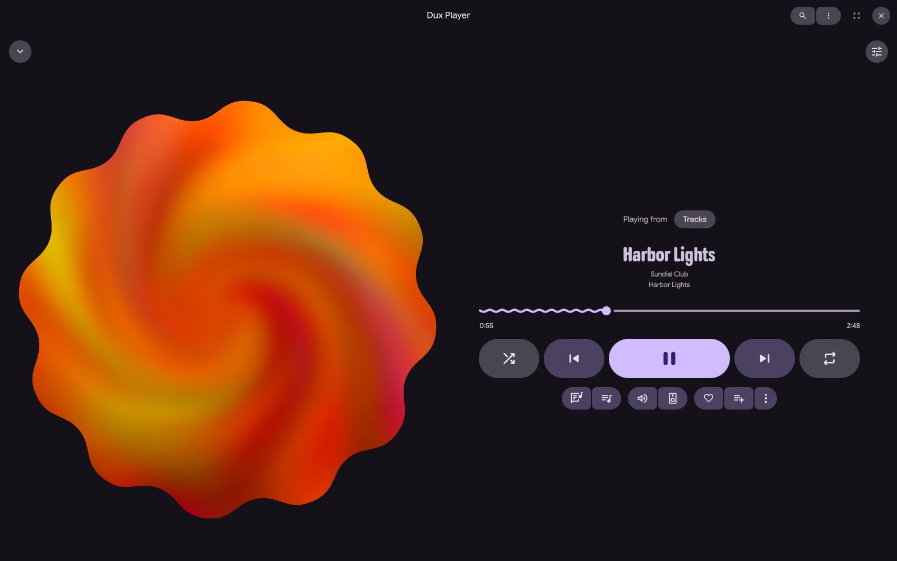
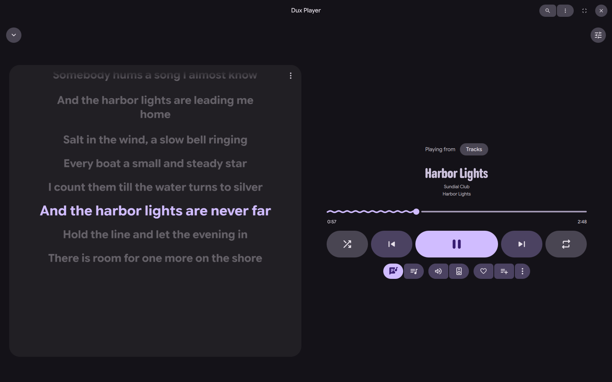
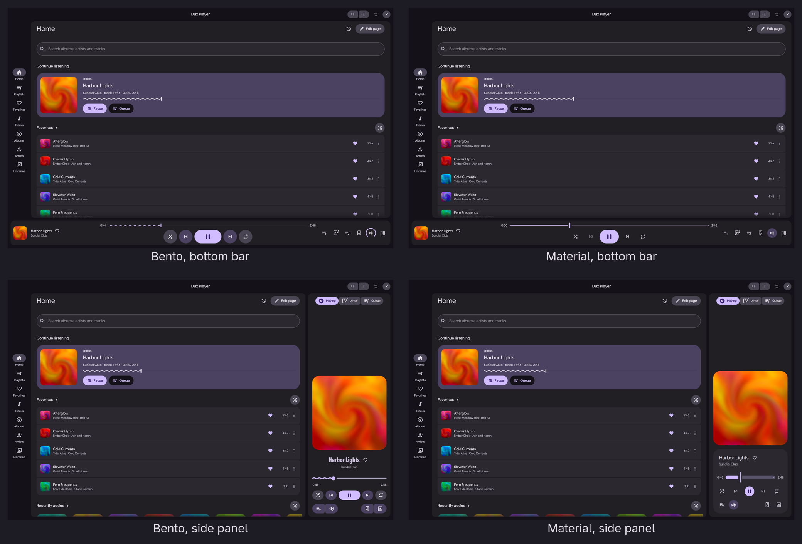
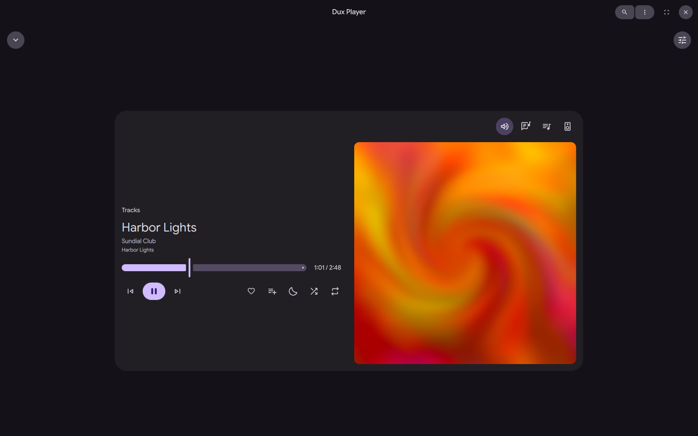
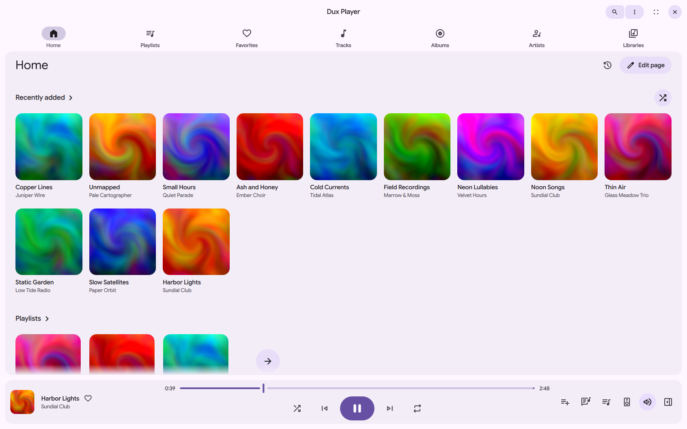
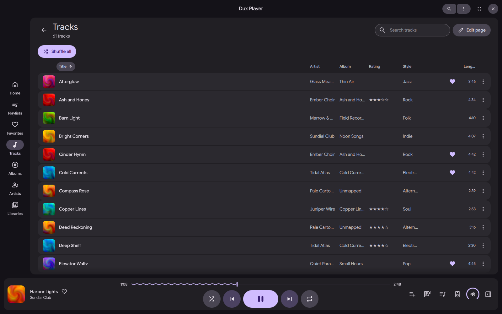
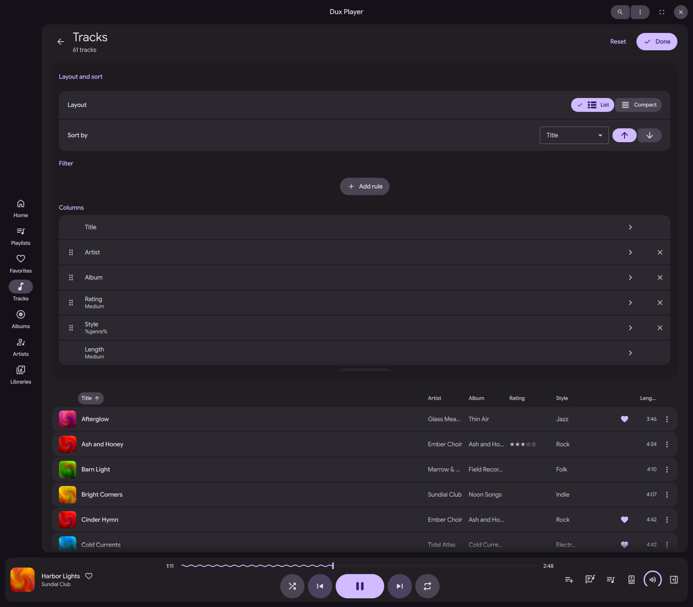
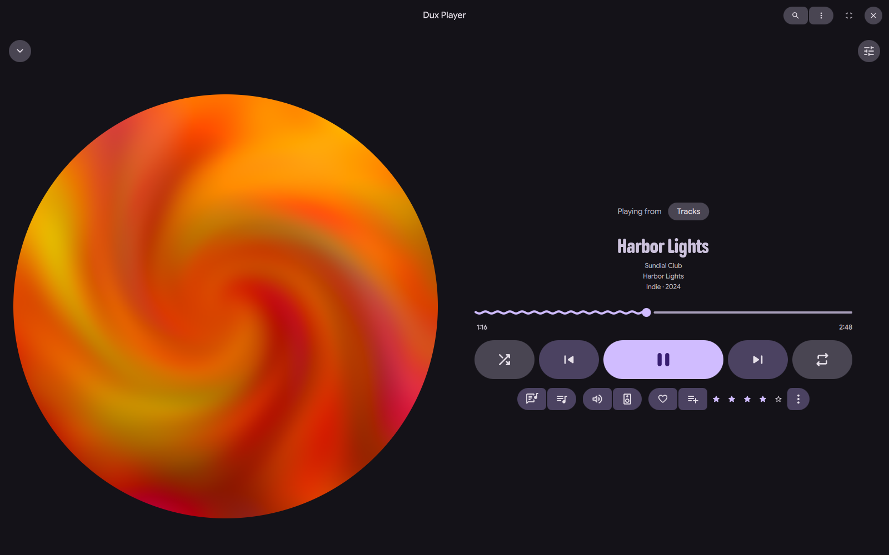
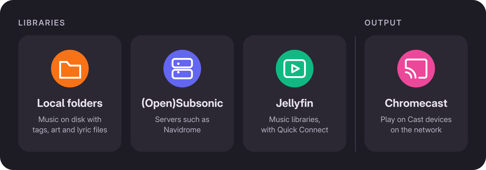

# Dux Player

A music player for Linux in the style of [Dux Shell](https://github.com/duxlabs-dev/dux-shell). 
It is intended for use within the Dux Shell and picks up its settings and theming, but can be run and configured standalone.
Dux Player plays local libraries and streams from Navidrome, Subsonic and Jellyfin servers.

> **Status: 0.0.1-alpha.** Early Development Version







<details>
<summary>More screenshots</summary>

Bottom bar and side panel, Bento and Material styles:



Full view, Material style:



Home with other shelves and layout:



Tracks page with custom columns:



Page editor:



A customized full view:



Supported libraries and outputs:



</details>

Pages, columns and the full view can be customized.

## Features
- Local libraries (several folders, indexed and watched) and any number of server libraries; Jellyfin also signs in with Quick Connect, so no password is stored
- Local playlists that mix tracks from any library, plus server native playlists; add a track to several at once and see which ones hold it
- Offline rules per server library, caching and preloading the next songs for a seamless experience; favorites and ratings set while a server is unreachable are sent once it is back
- Server catalogs are kept on the device once a first sync finishes: browsing and search are instant and work while the server is unreachable, where tracks without a cached copy show that they can't play. Checked every 15 minutes, read in full when the server reports a change (at most hourly), at least daily, and on Rescan; the sync waits on a metered connection unless started by hand
- Gapless playback, crossfade, volume normalization, skipping leading and trailing silence, equalizer several outputs at once
- Optional synced lyrics with word-by-word fill, in the full view and as one line in the bar, on by default, scrobbling (to ListenBrainz, Last.fm and the server), casting through [dux-cast](https://github.com/Conava/dux-cast)
- Keeps playing with the window closed; MPRIS, a tray icon and a CLI (`dplayer play`, `dplayer next`, …) for keybinds
- Phones can control the player over the network through KDE Connect or GSConnect (through MPRIS), until a LAN remote exists
- `dplayer watch` and `dplayer status --format` for status bars and scripts
- `dplayer sleep after <number>` stops when a queue entry ends, numbered as `dplayer queue` lists it; a rule behind the current track is dropped unless repeat all is on, and while casting the receiver gets the queue only up to that entry
- Text templates for a now-playing line and for custom columns in track lists; each column has its own title, Sort by field and width (small, medium or large, or drag the border between two columns; Length takes the three sizes only)
- Filter rules for track, album and artist pages: match all or any of a list of conditions on fields such as genre, library, rating, year, length, plays, date added and last played
- Stop after a chosen queue entry, shuffle by album, and rules for what shuffle all and auto-continue skip (genres, libraries, low ratings, short tracks); shuffling a named library ignores that library's skip entry
- Keep a single song on the device for offline play, from its menu; track tiles can open the album instead of playing; `dplayer keep library:id…` and `dplayer unkeep library:id…` do the same from the CLI
- When a track has no lyrics, the full view can fall back to the cover
- Now-playing bar, side panel and full view in Bento or Material design, with arrangeable elements, also in lines above and below the seekbar, a customizable home page and track lists, custom pages with their own rules, columns, limit, random order, grouping and icon, and searchable settings

## Requirements

- [Quickshell](https://quickshell.org) with Qt 6
- Recommended: mpv 0.38 or newer. Without it a built-in player plays FLAC, MP3, Ogg Vorbis, Opus, WAV and AIFF through PulseAudio or PipeWire (pipewire-pulse), but not AAC/M4A, ALAC, WavPack, APE or Musepack files; it has no crossfade, speed control, equalizer or several outputs at once, and can't seek in a track the server converts while it plays
- Go 1.27 to build
- Optional: ffmpeg (loudness and silence measurement, matching lyrics timing to the audio), PipeWire with WirePlumber (multiple outputs, equalizer, system volume), a Secret Service keyring (server passwords and sign-in tokens), `cast-helper` 0.2.0 or newer (casting)

## Build and run

```sh
git clone --recursive https://github.com/Conava/dux-player
cd dux-player
make run      # build and run against the QML in this checkout, with hot reload
```

To install it as a regular application for your user:

```sh
make build
make install PREFIX=~/.local
```

Install system-wide:

```sh
make build
make install
```

`make help` to list every target.

## Keyboard

These keys are fixed. Space, the arrows and F leave a text field or a control reached with Tab to that control.

| | |
|---|---|
| Space | Play or pause. |
| Left, Right | Seek back or forward 5 seconds. |
| Ctrl+Left, Ctrl+Right | Previous or next track. |
| F | Open or close the full now playing view. |
| Alt+Left, Alt+Right | Back or forward through the pages. |
| Mouse side buttons | Back or forward through the pages. |

## Text templates

The Text element of the now-playing surfaces, the Custom text line of track lists and `dplayer status --format` share one syntax:

| | |
|---|---|
| `%field%` | The field's value. An unknown name stays as typed. |
| `%a\|b%` | The first of the fields with a value. |
| `[ … ]` | Printed only if a field inside has a value: `%album%[ (%year%)]`. |
| `'…'` | Literal text, for `%`, `[`, `]` and `\|`. `''` is an apostrophe. |

Fields: `title`, `artist`, `artists`, `album`, `albumartist`, `composer`, `genre`, `year`, `tracknumber`, `discnumber`, `duration`, `rating`, `playcount`, `library`, `format`, `bitrate`, `added`, and `playingfrom` for the playing track. The CLI adds `state` (`playing`, `paused`, `stopped`).

## Scripts and status bars

`dplayer status --format '%artist% - %title%'` prints one line. `dplayer watch --format '…'` prints one on every track or play state change until Ctrl+C, and exits with an error when the daemon stops; without `--format` each line is a JSON event. Neither starts the player: with no daemon running they print nothing and fail, so a bar that retries picks the player up once it runs. A waybar module:

```json
"custom/dplayer": {
    "exec": "dplayer watch --format '[%artist% - %title%]'",
    "restart-interval": 5
}
```

## Troubleshooting

The daemon logs to `~/.local/state/dplayer/daemon.log` and the window to `ui.log` next to it, including mpv's warnings and the mpv version found at startup. To watch it live, run `dplayer quit`, then `dplayer daemon` in a terminal, and open the window.

A clone without `--recursive` has no `dux-qml-common`: run `git submodule update --init`.

## Online services

Dux Player only contacts the servers you add, except for these features, each of which can be turned off in Settings:

- **Artist information:** artist names are sent to MusicBrainz, Wikidata and Wikipedia, and to fanart.tv once you add your own API key. Last.fm gets them too, through the app's built-in API key or your own. Biographies from Wikipedia are available under [CC BY-SA 4.0](https://creativecommons.org/licenses/by-sa/4.0/).
- **Lyrics:** on by default. Title, artist, album and length of the playing track, of the next track while lyrics are open, and of downloaded tracks are sent to the enabled lyrics providers. Turn lyrics off in Settings → Lyrics and no provider is contacted; turn off Lyrics for downloaded tracks to send only tracks you play. Matching lyrics timing to the audio runs on this device and sends nothing.
- **Scrobbling:** played tracks are sent to ListenBrainz or Last.fm when you connect an account, from server libraries too unless you turn that off for a library. Last.fm uses the app's built-in API account; if you prefer, enter your own [API account](https://www.last.fm/api/account/create).

## Contributing

See [CONTRIBUTING.md](CONTRIBUTING.md).

## License

MIT, see [LICENSE](LICENSE). 
Tag reading and writing uses [TagLib](https://taglib.org) (LGPL-2.1) through [go-taglib](https://github.com/sentriz/go-taglib). 
The built-in player uses [flac](https://github.com/mewkiz/flac) (public domain), [go-mp3](https://github.com/hajimehoshi/go-mp3) (Apache-2.0), [oggvorbis](https://github.com/jfreymuth/oggvorbis) (MIT), [gopus](https://github.com/thesyncim/gopus) (BSD-3-Clause) and [pulse](https://github.com/jfreymuth/pulse) (MIT). 
`make install` puts the license text of every dependency in `share/licenses/dux-player/THIRD_PARTY_LICENSES`.
