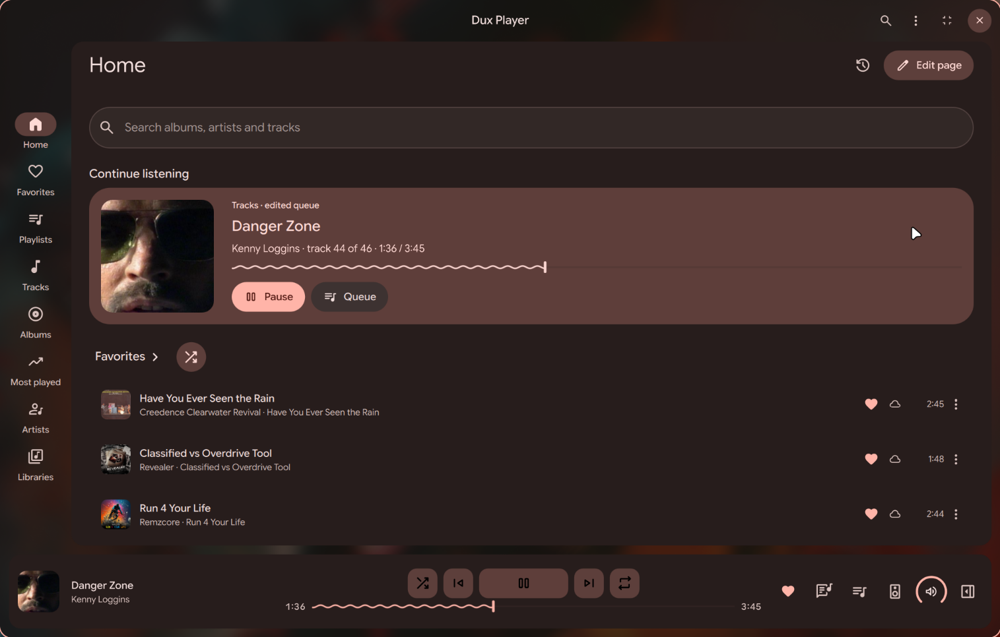
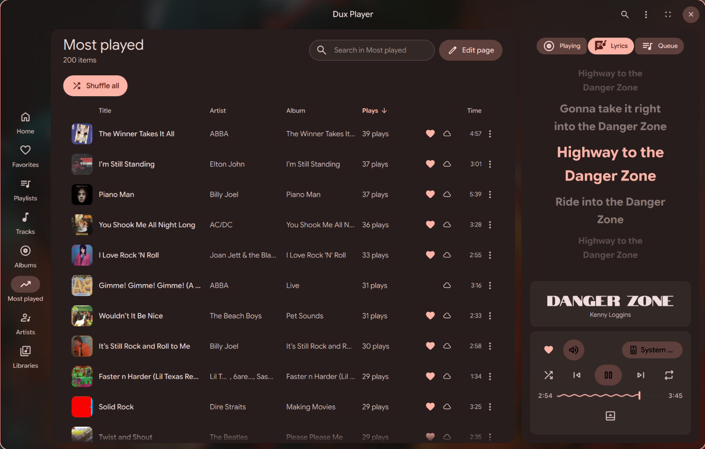
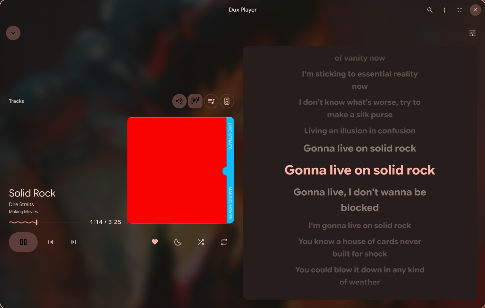

# Dux Player

A music player for Linux in the style of [Dux Shell](https://github.com/duxlabs-dev/dux-shell). 
It is intended for use within the Dux Shell and picks up its settings and theming, but can be run and configured standalone.
Dux Player plays local libraries and streams from Navidrome, Subsonic and Jellyfin servers.

> **Status: 0.0.1-alpha.** Early Development Version



| Side panel with lyrics | Full view |
|---|---|
|  |  |

## Features
- Local libraries (several folders, indexed and watched) and any number of server libraries
- Local playlists that mix tracks from any library, plus server native playlists
- Offline rules per server library, caching and preloading the next songs for a seamless experience
- Gapless playback, crossfade, volume normalization, skipping leading and trailing silence, equalizer several outputs at once
- Synced lyrics, scrobbling (through the server, or to ListenBrainz and Last.fm), casting through [dux-cast](https://github.com/Conava/dux-cast)
- Keeps playing with the window closed; MPRIS, a tray icon and a CLI (`dplayer play`, `dplayer next`, …) for keybinds
- Fully customizable now-playing bar, side panel and full view in Bento or Material design as well as customizable home page, lists and menus

## Requirements

- [Quickshell](https://quickshell.org) with Qt 6, and mpv 0.38 or newer
- Go 1.27 to build
- Optional: ffmpeg (loudness and silence measurement), PipeWire with WirePlumber (multiple outputs, equalizer, system volume), a Secret Service keyring (server passwords), `cast-helper` (casting)

## Build and run

```sh
git clone --recursive https://github.com/Conava/dux-player
cd dux-player
make run      # build and run against the QML in this checkout, with hot reload
```

To install it as a regular application for your user:

```sh
make build
make install PREFIX=~/.local
```

Install system-wide:

```sh
make build
make install
```

`make help` to list every target.

## Online services

Dux Player only contacts the servers you add, except for these features, each of which can be turned off in Settings:

- **Artist information:** artist names are sent to MusicBrainz, Wikidata and Wikipedia, and to fanart.tv and Last.fm once you add your own API key. Biographies from Wikipedia are available under [CC BY-SA 4.0](https://creativecommons.org/licenses/by-sa/4.0/).
- **Lyrics:** track title, artist, album and duration are sent to the enabled lyrics providers.
- **Scrobbling:** played tracks are sent to ListenBrainz or Last.fm when you connect an account. Last.fm needs your own [API account](https://www.last.fm/api/account/create).

## Contributing

See [CONTRIBUTING.md](CONTRIBUTING.md).

## License

MIT, see [LICENSE](LICENSE). 
Tag reading and writing uses [TagLib](https://taglib.org) (LGPL-2.1) through [go-taglib](https://github.com/sentriz/go-taglib)
